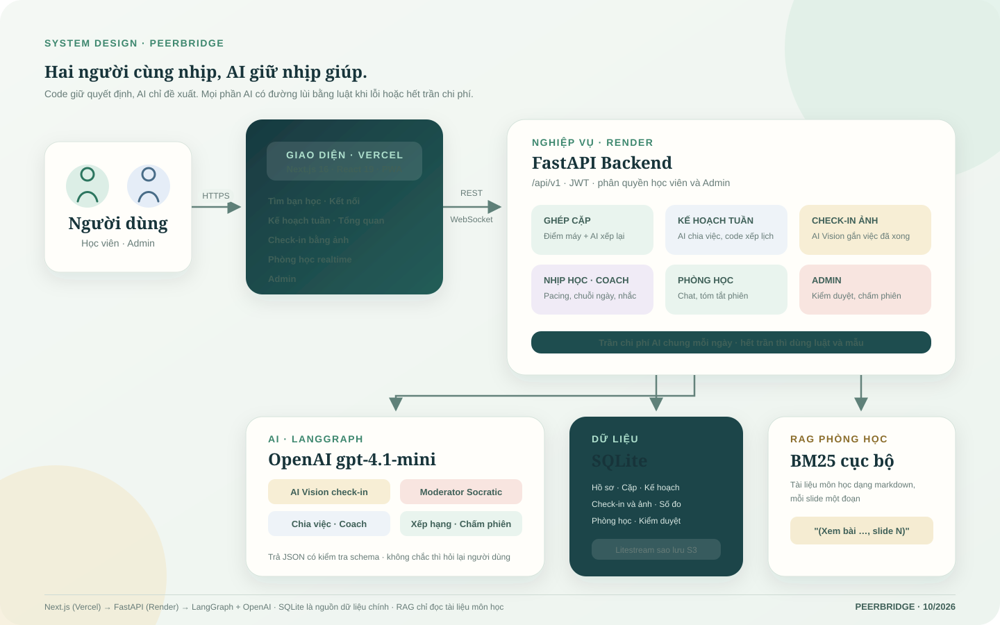

# Kiến trúc PeerBridge

## Tổng quan

| Lớp | Công nghệ | Chạy ở đâu |
| --- | --- | --- |
| Giao diện | Next.js 16, React 19, TypeScript, PWA | Vercel |
| API | FastAPI, REST dưới `/api/v1` và WebSocket cho phòng học, JWT | Render |
| AI | LangGraph điều phối; OpenAI `gpt-4.1-mini` qua API tương thích OpenAI | Gọi từ backend |
| Dữ liệu | SQLite (ảnh check-in lưu trong database), sao lưu tùy chọn bằng Litestream lên S3 | Ổ đĩa của server Render |
| RAG | BM25 trên markdown tài liệu môn học trong `backend/data/courses/` | Trong tiến trình backend |

Nguyên tắc chung:

- **Code giữ quyết định, AI chỉ đề xuất.** Ngày giờ của kế hoạch, quyền xem dữ liệu, trạng thái hoàn thành, việc có phát tin
  hay không đều do code quyết định. AI chọn trong các phương án code đã lọc sẵn và trả về JSON có kiểm tra schema.
- **Luôn có đường lùi.** Mỗi phần AI có bản luật hoặc mẫu. Lỗi, quá thời gian hay hết trần chi phí thì dùng bản đó.
- **Một trần chi phí chung.** `loop/ai_budget.py` ghi sổ mọi lần gọi AI và chặn khi vượt `VISION_DAILY_BUDGET_USD` (mặc định 2 USD/ngày).

## Các phần chính

### 1. Hồ sơ và ghép cặp

- Hồ sơ gồm mục tiêu, điều cần hỗ trợ, điều giúp được, giờ rảnh (`routers/profiles.py`, `repositories/profiles.py`).
- Danh mục concept chuẩn ở `data/concepts/catalog.json`: 30 SQL, 30 Python, 15 bài khóa AICB, có quan hệ tiên quyết (`onboarding/`).
- Điểm ghép cặp tính bằng code: bài bổ trợ (mình cần, bạn giỏi), chủ đề chung, giờ rảnh trùng, mục tiêu gần nhau
  (`services/matching_engine.py`, `matching/`). Khi `MATCH_RERANK_ENABLED=true`, LLM xếp lại nhóm đầu và viết lý do
  (`services/match_ai.py`).
- Hai bên cùng đồng ý mới thành cặp (`routers/connections.py`). Mỗi cặp có `pair_id` dùng chung cho kế hoạch, check-in và đo nhịp học.

### 2. Kế hoạch tuần

`services/plans.py`, `agents/plan_coach/`.

1. Form gợi ý sẵn concept khớp điều người học cần (`suggested_concept_ids`). Người học chỉnh mục tiêu, số phút cam kết, giờ rảnh.
2. LLM chia mỗi concept thành việc cụ thể (việc, đầu ra, số phút). Lỗi thì dùng việc mẫu trong `plan_catalog.json`.
3. Bộ xếp lịch (`scheduler.py`) đặt việc vào giờ rảnh theo thứ tự tiên quyết, tránh lịch phiên học đã đặt, không vượt số phút cam kết.
   Việc không xếp được thì hoãn kèm lý do.
4. Kế hoạch có phiên bản. Xếp lại (giảm tải) chỉ dùng code, không gọi AI.

### 3. Check-in bằng ảnh (AI Vision)

`checkin/`. Một LangGraph bốn bước: `load_context → analyze → decide → persist`.

- `load_context`: lấy các việc trong kế hoạch **đã tới giờ** và điểm mạnh của bạn cặp.
- `analyze`: mô hình đọc ảnh (thu về cạnh dài 1568px) và ghi chú, trả concept đang học, mô tả, độ tin cậy.
- `decide`: tin cậy cao thì tự gắn vào việc trong kế hoạch; trung bình thì hỏi lại bằng tối đa 3 gợi ý; thấp thì để người học tự chọn.
- `persist`: lưu kết quả, gọi `PlanService.complete` để đánh dấu xong, báo bạn cặp kèm câu cầu nối nếu bạn cặp giỏi phần đó.

Ảnh chỉ người học và bạn cặp xem được. Thông tin cá nhân trong ảnh không được chép vào ghi chú của AI.

### 4. Đo nhịp học và coach

`metrics/`, `loop/`, `services/coach.py`.

- Sau mỗi check-in và theo chu kỳ (`LOOP_INTERVAL_MINUTES`), `loop/trigger.py` tính lại số đo của cặp: pacing
  (phút đã xong ÷ phút đáng lẽ xong tới hôm nay), chuỗi ngày cả hai cùng học, khoảng cách giữa hai người, rủi ro bỏ cuộc.
- Coach là một LangGraph: `load_context → eligibility → decide → validate_action → prepare_action → save_log`.
  Chỉ nhắc khi có việc quá hạn, tối đa 1 lần mỗi người mỗi ngày, không nhắc 22:00–07:00. LLM viết lời nhắc; có A/B với câu mẫu.
- Trang Tổng quan (`home/overview.py`) đọc trực tiếp kế hoạch và check-in: việc hôm nay, tuần này, số phút đã học, chuỗi ngày.

### 5. Phòng học và moderator

`services/study_room.py`, `routers/study_room.py`, `agents/moderator/`.

- Phòng học dùng WebSocket `/api/v1/ws/sessions/{id}`, kiểm tra JWT và thành viên trước khi nhận tin.
- Mỗi tin qua moderator LangGraph: `preflight_rules → classify_intent → assess_risk → choose_action → retrieve_context →
  generate_guidance → output_guard → verify_contract`.
  - Chat thường (chào hỏi, hẹn giờ) được lọc bằng luật, không gọi AI.
  - Kết quả là `ALLOW`, `GUIDE`, `WARN`, `BLOCK` hoặc `ESCALATE`. Chỉ `ALLOW` và `GUIDE` mới được phát cho cả phòng.
  - Khi người học xin đáp án, AI hỏi gợi mở từng bước và trích nguồn "(Xem bài …, slide N)" từ tài liệu môn học.
  - `output_guard` chặn câu trả lời lộ lời giải.
- "Kết thúc & tóm tắt" tạo bản tóm tắt phiên. Admin bấm "Chấm phiên bằng AI" để LLM-as-judge chấm mức tuân thủ Socratic
  và việc có lộ đáp án hay không (`session_review/`).

### 6. Admin

`admin_roles.py`, `moderation_admin.py`, `routers/instructor_moderation.py`. Tài khoản có email trong `ADMIN_EMAILS` (hoặc
"Vào thử: Admin" ở chế độ demo) xem được tổng quan, mọi phiên học và hàng đợi kiểm duyệt. Tin bị giữ được báo realtime vào chuông Admin.

## Dữ liệu

- Toàn bộ dữ liệu nằm trong một file SQLite (`DATABASE_PATH`). Bảng được tạo khi khởi động (`app/db.py`); Alembic giữ lịch sử
  thay đổi trong `backend/alembic/versions/`.
- Các nhóm bảng: người dùng và hồ sơ; kết nối và cặp; `pb_plans`, `pb_plan_items` (kế hoạch); `vi_checkins` (check-in);
  `pair_metrics_daily` (số đo); `pb_interventions` (coach); phòng học, tin nhắn, log kiểm duyệt, `session_reviews`.
- Gói Free của Render không giữ ổ đĩa. Bật Litestream (xem `docs/DEPLOY.md`) để sao lưu và tự khôi phục.

## Đánh giá

Thư mục `eval/` chứa bộ dữ liệu, script và kết quả cho từng phần AI: `concept`, `matching`, `plan`, `nudge` (coach),
`vision`, `moderator`, `measurement`. Test backend (`backend/tests`) chỉ dùng provider giả, không gọi API thật.
